<h1 align="center">Constrained Generation Library</h1>

<p align="center">
  <em>A structured-generation library built from scratch in pure Python. It compiles a JSON Schema into a finite automaton and masks a model's tokens so the output can only be valid. 100% valid JSON, by construction.</em>
</p>

<p align="center">
  <a href="https://github.com/adeoluo/constrained-generation-library/actions/workflows/ci.yml"></a>
  
  
  
  
  
</p>

---

## Motivation

Getting a language model to emit valid structured output (JSON matching a schema, a value from an
enum, a well-formed number) is usually attempted with prompting and retries, which fails
unpredictably. The reliable approach is to **constrain decoding**: at each step, only allow tokens
that keep the output on a path to a valid document. This library implements that from scratch. It
compiles a schema into a regular expression, compiles the expression into a finite automaton, and
uses the automaton to mask the model's vocabulary so **invalid output is impossible**, with **zero
runtime dependencies**.

The guarantee is not probabilistic. Across any model, constrained decoding here produces valid
JSON **100% of the time**; the same models unconstrained produce it **0% of the time**.

## Architecture

<p align="center">
  
</p>

A schema becomes a regular expression, which is parsed into a Thompson NFA and run as a lazy DFA
(each state is an epsilon-closed set of NFA states, transitions computed on demand). During
decoding, the automaton reports which tokens keep the output acceptable; the model's scores are
masked to that set. See the [ADRs](docs/adr/) for the key decisions.

## What it implements

- **A regular-expression engine** from scratch: parser, Thompson NFA construction, and a lazy DFA
  with literals, classes, the wildcard, escapes, ``* + ?``, alternation, and grouping.
- **A JSON Schema compiler** for objects with ordered typed properties (string, integer, number,
  boolean, enum), producing a regular expression for compact JSON that respects the JSON number
  grammar (no leading zeros).
- **Token-level masking**: a token is allowed only if feeding its characters never drives the
  automaton into a dead state; an end-of-sequence token is allowed only in an accepting state.
- **Constrained decoding** that masks any model's scores to the allowed set.

## Results

> Reproduce with `python -m constrained_generation_library report`. Each trial draws a different
> random model and generates a document with and without the constraint.

| Metric (200 random models) | Value |
|---|---:|
| **constrained outputs that are valid JSON** | **100% (200/200)** |
| unconstrained outputs that are valid JSON | 0% (0/200) |
| mean fraction of the vocabulary allowed per step | 0.168 |

Constrained decoding is valid **every time**; the same models, unconstrained, are valid **never**.
On average the automaton prunes about **83% of the vocabulary at each step**, which is exactly the
mask that keeps generation on a legal path.

### Scale

> Reproduce with `uv run python benchmarks/scale.py`. Schemas of increasing field count, each with
> enough decoding budget to complete the object; peak memory from `tracemalloc`.

| Schema | Generations | Time | Throughput | Valid JSON |
|---|---:|---:|---:|---:|
| 4 fields | 60 | 4.5 s | ~13.4 gen/s | 60/60 |
| 8 fields | 40 | 5.4 s | ~7.4 gen/s | 40/40 |
| 12 fields | 30 | 5.7 s | ~5.3 gen/s | 30/30 |
| 16 fields | 20 | 3.8 s | ~5.3 gen/s | 20/20 |

Validity stays **100%** as the schema grows, because output is valid by construction; throughput
falls because larger objects require more decoding steps, each masking the vocabulary against the
automaton. Peak memory for a single 16-field generation is about 665 KiB. These are pure-Python
numbers that show how the masking machinery scales, not competitive speed against a production
constrained-decoding framework.

## Demonstration

```text
$ python -m constrained_generation_library pattern
\{"name":"([^"])?...","age":-?(0|[1-9]\d?\d?),"active":(true|false),"role":("admin"|"user"|"guest")\}

$ python -m constrained_generation_library generate --seed 7
generated: {"name":",9GajsaR","age":0,"active":true,"role":"user"}
valid:     True
```

The generated document parses as real JSON and matches the schema, even though the underlying
"model" is assigning random scores to tokens.

## Quickstart

```bash
git clone https://github.com/adeoluo/constrained-generation-library.git && cd constrained-generation-library
make setup                      # install dev tooling + pre-commit hooks
make all                        # lint + type-check + test

python -m constrained_generation_library report      # validity with and without the constraint
python -m constrained_generation_library generate     # one schema-valid document
python -m constrained_generation_library pattern       # the compiled regular expression
python -m constrained_generation_library serve         # start the HTTP service on :8000
```

```python
from constrained_generation_library import (
    Property,
    compile_schema,
    constrained_generate,
    default_vocab,
    random_model,
)

schema = [Property("name", "string", max_length=10), Property("age", "integer", max_length=3)]
regex = compile_schema(schema)
result = constrained_generate(regex, default_vocab(), random_model(0))
assert regex.fullmatch(result.text)
```

## HTTP service

A standard-library HTTP service compiles the schema at startup, then validates and generates. The
routing logic is a pure function, tested without a socket.

| Method | Path | Purpose |
|---|---|---|
| GET | `/health` | liveness and the active schema pattern |
| GET | `/ready` | readiness once the schema is compiled |
| GET | `/metrics` | per-route request, error, and latency metrics (Prometheus text) |
| POST | `/validate` | body `{"text": str}`; whether the text matches the schema |
| POST | `/generate` | body `{"seed": int?}`; a schema-valid document from a seeded model |
| GET | `/report` | validity rate with and without the constraint over random models |

## Design decisions

- **A lazy DFA over NFA state sets** - computing transitions on demand avoids enumerating the
  alphabet and is exactly what token masking needs. See [ADR 0002](docs/adr/0002-lazy-dfa.md).
- **Bounded schema fields** - bounding string length and integer digits keeps the automaton finite
  and guarantees that decoding completes, so validity is about complete documents, not just
  prefixes. See [ADR 0003](docs/adr/0003-bounded-fields.md).

## Evaluation

Schemas, models, and generations are deterministic, so every number reproduces offline. Full
method and tables: [`docs/EVALUATION_REPORT.md`](docs/EVALUATION_REPORT.md).

## Responsible AI

- **Model card:** [`docs/MODEL_CARD.md`](docs/MODEL_CARD.md)
- **Data card:** [`docs/DATA_CARD.md`](docs/DATA_CARD.md)
- **Threat model:** [`docs/THREAT_MODEL.md`](docs/THREAT_MODEL.md)

## Comparison scope

The results above compare constrained decoding against unconstrained decoding with random
models over a bounded schema subset, not against an established constrained-decoding library.
This project has **not** been benchmarked against [Outlines](https://github.com/dottxt-ai/outlines)
or [Guidance](https://github.com/guidance-ai/guidance) on latency, schema coverage, or correctness
over realistic tokenizer vocabularies, and it does not claim to beat them. What the result
establishes is narrower and precise: automaton-based token masking makes output valid by
construction. A controlled comparison against those libraries is the natural next step.

## Limitations

- There is no language model here; a deterministic fake model stands in so the constraint can be
  demonstrated offline. The library is the masking machinery a real decoder would call.
- The regular-expression engine supports a practical subset, not the full syntax (no backreferences
  or ``{n,m}`` counts); bounded repetition is expressed by expansion.
- The JSON Schema compiler covers flat objects with the listed scalar types, not nested objects or
  arrays. Property names and enum values are matched against their exact JSON serialization, so keys
  containing quotes, backslashes, or control characters are handled correctly.
- String **values** are modelled as a bounded run of non-quote characters, which does not yet accept
  JSON escape sequences inside the value (for example an embedded ``\"`` or ``\n``). This is a known
  boundary of the value grammar, separate from key handling, and is noted in the roadmap.

## Roadmap

- [ ] Benchmark against Outlines and Guidance on latency, schema coverage, and correctness over a real tokenizer vocabulary.
- [ ] Support nested objects and arrays in the schema compiler.
- [ ] Model full JSON string-value escaping (embedded ``\"``, ``\\``, ``\n``, ``\uXXXX``) in the value grammar.
- [ ] Add a context-free grammar front end for non-regular structure.
- [ ] Cache token masks per automaton state for faster decoding.

## License

[MIT](LICENSE)
